# WB-700: Phase 1 Technical Design Document

**Techfest 2026-27 · The Wrecking Ball Challenge · Phase 1 (Registration & CAD Abstract)**

Autonomous, battery-powered, pendulum-driven spherical robot · CAD and system concept

## 1. Project title and team information

| Field | Entry |
|---|---|
| Project title | **WB-700: autonomous pendulum-driven spherical robot** (working name, may be changed by the team) |
| Team ID / Team name | TM-47C20DF8A48 / StarDust |
| Institution | Madan Mohan Malaviya University of Technology, Gorakhpur |
| Team lead | Abhishek Kumar Singh \| abhishekkrsingh2345@gmail.com \| 8429339626 |
| Members (max. 6) | Abhishek Kumar Singh (lead) · Gaurav Singh Rajpoot · Abhinav Rai · Naman Singh · Animesh · Ansh Pandey |
| Document | Phase 1 Technical Design Document, revision P1.0, {{date}} |
| Status | Concept design for the Round 1 design audit. **No hardware has been built or tested.** |

All numbers come from the parametric CAD model (`cad/`) and its analysis scripts unless marked as an
assumption, datasheet value or estimate. Placeholder hardware is labelled **PH**.

## 2. Executive summary

WB-700 is a **{{D_shell}} mm ({{D_shell_ft}} ft) polycarbonate sphere** that moves by shifting its own
centre of gravity. A gravity-held internal frame, the **stator**, hangs on a stationary hollow axle that
runs between the two poles of the shell. Two 24 V gearmotors on the stator drive ring gears bolted to the
shell's pole flanges. Their torque swings the stator forward, the CG moves ahead of the contact point and
the ball rolls. A **steering bob**, made of the 6S Li-ion battery and laser-cut steel ballast arcs, hangs
45 mm below the axle on a longitudinal pivot. Tilting it ±30° leans the ball ±{{lean30}}° (static) to
steer. A Raspberry Pi 5 runs all vision and navigation onboard. An RP2350-class MCU closes the 500 Hz
motor, pendulum-damping and camera-stabilisation loops. An independent hardware safety chain implements
the wireless kill switch.

Key results from the CAD model:

- **Dimensional compliance:** all calipers {{d_min}}-{{d_max}} mm ({{d_min_ft}}-{{d_max_ft}} ft), strictly
  inside 2.0-2.5 ft, with {{margin_up}} mm / {{margin_low}} mm margins. No external sensors or mounts.
- **Mass and CG:** {{M}} kg in total ({{ph_mass}} kg of it placeholders); **CG at ({{cg_x}}, {{cg_y}},
  {{cg_z}}) mm** from the shell centre. The pendulum first moment is {{mpe}} kg m.
- **Packaging checks:** no clashes between {{n_parts}} parts in {{clash_states}} pitch/tilt states; at
  least {{clr_skin}} mm from the frame/bob to the shell at any pitch angle and over ±30° bob tilt. The
  camera view is {{cam_blk_max}} % obstructed in {{cam_states}} bob/servo poses (CAD sightlines only). The battery can be removed without disturbing the ballast.
- **Preliminary ramp capability:** {{a60}}° steady climb including rolling resistance, with the baseline 4
  ballast plates ({{a60_min}}-{{a60_max}}° with 2-6 plates). Conditional, because the ramp slopes are not
  published. For steeper ramps the energy for the 0.8 ft rise corresponds to a run-up of {{v20}} m/s (20°) to
  {{v30}} m/s (30°); this is an energy estimate only, not a demonstration of traction or crest control.

The design is original. The reference projects reviewed (SphBot, Rollie, Integral-Robotics-Lab
Spherical-Robot) informed the choice of principle only; no CAD, code or text was reused.

## 3. Problem statement and competition objectives

The official problem statement (5 pages; checked against techfest.org on 2026-10-20 with no date
conflict) asks for *"an autonomous, battery-powered spherical robot that navigates a 75-meter
obstacle-laden arena using vision-based navigation, center-of-gravity stabilization, and real-time
obstacle evasion."*

| Item | Requirement (official) | Design consequence |
|---|---|---|
| Geometry | Spherical, diameter strictly between 2.0 and 2.5 ft (609.6-762.0 mm) | 700 mm nominal: margin on both sides |
| Housing | All computing, power, actuators and electronics completely inside | Everything inside; the polar hubs are recessed |
| Peripherals | Sensors, mounts and lenses ≤ 0.5 ft (152.4 mm) beyond the shell | None used; camera inside |
| Power | Strictly onboard battery; no tether or remote power | 6S1P Li-ion, about 97 Wh |
| Autonomy | 100 % autonomous; no remote control, intervention or offboard processing | Pi 5 + MCU onboard; RF link is e-stop only |
| Sensors | Onboard camera primary; supplementary internal IMU, encoders, distance sensors for stabilisation | Camera primary; IMU + encoders internal |
| Safety | Operational wireless kill switch that immediately stops all motor actuation | Heartbeat e-stop, three independent cut channels |
| Track | S1 gate runway 0-15 m; S2 ramps 0.2/0.4/0.8 ft (15-35 m); S3 low-density obstacles (35-55 m); S4 swinging pendulum (55-75 m); red cones right, yellow left | Drive torque, traction, robustness, timing |
| Scoring | Run time + 5 s per cone contact; best of 3 attempts; DNF ranked by distance | Reliability first, then speed |
| Phase 1 | CAD assembly with internal electronic layout, CoG placement, system schematic; judged on CAD, schematics, dimensional compliance | This document and the abstract |

The official site also publishes a **Round 1 submission template** (Google Doc). The companion
*Phase1_CAD_Abstract* follows it heading by heading.

## 4. Design requirements and compliance matrix

The full traceability matrix ({{n_req}} rows: requirement, mandatory or design-dependent, design
response, evidence, verification method, status) is in **Requirements_Compliance.csv**. Summary:

{{TABLE_REQ_SUMMARY}}

Derived design requirements (team targets, not rules):

| ID | Derived requirement | Target | Status |
|---|---|---|---|
| DR1 | Diameter margin to both limits, including forming tolerance | ≥ 25 mm each side | {{margin_low}} / {{margin_up}} mm: met |
| DR2 | Moving parts to shell clearance (frame and bob) | ≥ 8 mm | {{clr_skin}} mm: met |
| DR3 | Camera view free of internal obstructions | < 0.5 % blocked | {{cam_blk_max}} % in {{cam_states}} poses: met (CAD only) |
| DR4 | CG below the shell centre with low lateral offset | z ≤ -60 mm, abs(y) ≤ 2 mm | z = {{cg_z}}, y = {{cg_y}} mm: met |
| DR5 | Quasi-static incline capability incl. rolling resistance (pendulum ≤ 60°) | ≥ 12° (baseline) | {{a60}}°: not met with 4 plates; 6 plates give {{a60_max}}°; ramp angle TBC |
| DR6 | Battery below 100 Wh for transport | < 100 Wh | ≈ 97 Wh: met |
| DR7 | E-stop removes power from every actuator; fail-safe on signal loss | 3 channels, latched | design: met; latency to be tested in Phase 2 |
| DR8 | Battery removable without disturbing CG hardware | path clear | clear (CAD envelope check) |

## 5. Proposed robot concept

| Parameter | Value | Basis |
|---|---|---|
| Shell | Clear PC, OD {{D_shell}} mm, wall {{t_shell}} mm (nominal) | design parameter |
| Total mass / CG | {{M}} kg / ({{cg_x}}, {{cg_y}}, {{cg_z}}) mm | CAD mass table |
| Drive | Two-axis pendulum; 2 × 24 V gearmotors, 18T/72T m1.5 gears ({{gear_ratio}}:1) to both shell poles | concept |
| Steering | Bob ({{m_bob}} kg) tilts ±30° about a pivot 45 mm below the axle; self-locking worm gearmotor | CAD |
| Compute | Raspberry Pi 5 (8 GB) + RP2350-class motor MCU | selected reference + PH |
| Primary sensor | Raspberry Pi Camera Module 3 Wide (102° × 67°), on a pitch-stabilising servo | datasheet |
| Supplementary sensors | 9-DoF IMU, drive encoders, shell-index Hall, steering-angle sensor (all internal) | PH |
| Power | 6S1P Li-ion 21700 (Molicel P45B), 21.6 V, 4.5 Ah, ≈97 Wh, BMS | datasheet |
| Safety | Heartbeat wireless e-stop; contactor + driver PWM gate + changeover brake relays; arming plug in left hub | concept |

**How it moves.** On level ground at rest, the pendulum ({{m_pend}} kg, CG {{z_pend_abs}} mm below the
axle) hangs vertically. A drive torque T between stator and shell rotates the stator forward by phi.
The CG then moves forward by e·sin(phi), and the ball rolls to bring it back over the contact point. The
largest torque the pendulum can react is m_p·e·g = {{Tr90}} N m. **Steering:** tilting the bob by beta
moves the CG sideways. The ball leans by gamma ≈ {{lean30}}° at beta = 30° (CAD), and a leaning rolling
sphere turns. **Vision:** the camera sits on the stator, so it does not spin with the shell. It looks
forward through the clear shell 50 mm left of the seam plane, so the seam appears as a fixed, maskable
stripe.

## 6. Justification for the selected internal drive mechanism

Three principles were compared (detail in `research/Mechanism_Research_and_Selection.md`):

| Criterion (this track) | A. Two-axis pendulum | B. Internal drive unit (wheel cart) | C. Twin-hemisphere differential |
|---|---|---|---|
| Torque path | Gear into the shell, no slip | Wheel-to-shell friction; slips on ramps and impacts | Gear/bearing, but edge contact at the gap |
| Steering authority | Lean steering; no turn-in-place | Turns in place | Differential yaw |
| Barrier impacts | Pendulum cannot derail | Cart can climb or derail | Debris enters the equatorial gap |
| CG height achievable | Low (bob within 25 mm of the band) | Lowest | Moderate |
| Packaging and clearance proof | Pendulum sweeps a sphere about the centre: easy to prove | Cart, mast, sprung idlers | Large bearings at the equator |
| Vision | Stator camera through clear PC; seam masked | Views through the band the wheels scuff | Open gap, exposed to debris |
| Manufacturing | Plates, tube, stock bearings and gears | Moderate | Two precision large bearings |
| **Score (/55, judgement)** | **44** | 36 | 38 |

**Physics behind the choice.** For any barycentre-offset drive the quasi-static incline limit is
`sin(a_max) = (m_p e / (M R))·sin(phi_max)`. The required shell torque is `T = M g R (sin a + c_rr cos a)`.
The pendulum must react T by gravity, so motor torque beyond `m_p e g` is useless. Climbing capability is
therefore a *CG problem*, which the competition emphasises, and the pendulum architecture makes it
explicit and tunable with ballast. Option B's theoretical advantage, a lower cart, depends on
inner-shell friction μ ≥ tan(phi_cart) (≈0.84 at 40°). That is unreliable on clean or dusty
polycarbonate and degrades exactly where the camera looks. On a linear 75 m course of sequential sectors
(shape to be confirmed: Q4), turning in place is not needed; gate-to-gate corrections are, and lean
steering provides ±{{lean30}}° of lean.

**Reference projects (investigated, not copied):**
[SphBot](https://github.com/alirezaahmadi/SphBot), a pendulum-driven sphere with split shell and gear
drive (MIT, © 2019 A. Ahmadi; Kolbari et al., IcRoM 2018).
[Rollie](https://github.com/dformoso/rollie), a 120 mm stator-and-shell ball with Camera Module 3 Wide and
OpenSCAD sources (MIT, © 2025 D. M. Formoso).
[Integral-Robotics-Lab/Spherical-Robot](https://github.com/Integral-Robotics-Lab/Spherical-Robot), a
pendulum ball with an ESP32-CAM (no licence file found, so nothing was reused). The commercial Rotundus
GroundBot (pendulum drive, 60 cm, 25 kg) shows the principle at this scale.

## 7. Overall CAD design and dimensions

**Workflow.** The CAD is a parametric **CadQuery 2.8** (OpenCASCADE B-rep, the kernel FreeCAD also uses)
Python model. `cad/wb700_params.py` holds every dimension and mass assumption.
`cad/wb700_model.py` builds {{n_parts}} named, coloured solids in five rigid bodies: shell, stator, bob,
and envelopes. `cad/build_all.py` regenerates the analysis, the STEP assembly (opens in FreeCAD, Fusion,
SolidWorks and others), per-part STL, a coloured GLB, and every figure. OpenSCAD and FreeCAD were not
installed in the build environment, so a single executable source of truth was preferred over two
parallel models.

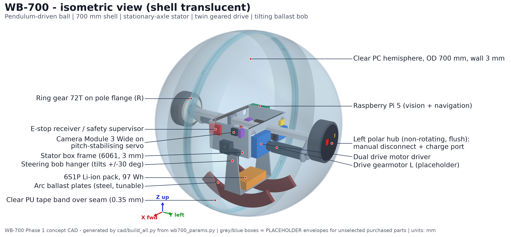{: .fig}
*Figure 1 - Isometric render of the complete assembly (shell translucent).*

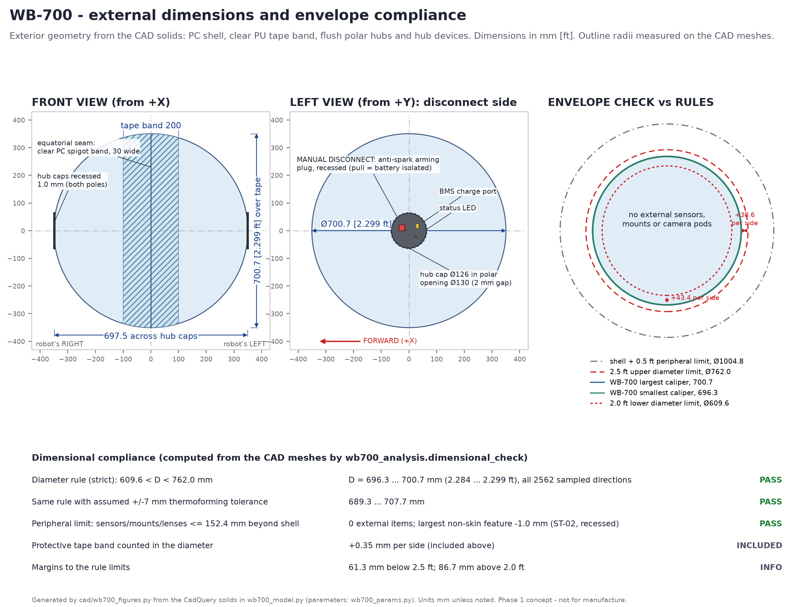{: .fig}
*Figure 2 - External dimensions and envelope check (computed from the CAD meshes).*

| Key dimension | Value |
|---|---|
| Shell outer diameter / wall | {{D_shell}} mm / {{t_shell}} mm PC |
| Diameter over tape band (max caliper) | {{d_max}} mm ({{d_max_ft}} ft) |
| Minimum caliper (across recessed hubs) | {{d_min}} mm ({{d_min_ft}} ft) |
| Polar opening / hub cap | Ø{{pole_open}} mm / Ø{{hub_cap}} mm, cap recessed 1.0 mm |
| Equatorial band | {{band_w}} mm wide, {{band_t}} mm thick, clear PC |
| Axle | Ø{{axle_od}} × {{axle_wall}} mm 6061-T6 tube, {{axle_len}} mm long, hollow harness duct |
| Pole bearings | 61908-2RS (40 × 62 × 12 mm), 2× |
| Gear stage | 72T / 18T, m{{gear_m}}, centre distance {{gear_cd}} mm |
| Stator box | {{box_l}} × {{box_w}} × {{box_h}} mm (6061 plates, 3 mm) |
| Steering pivot | 45 mm below axle; ±30° range, rubber end-stops at ≈32° |
| Ballast arcs | R{{rho_in}}-R{{rho_out}} mm about the pivot, ±{{ball_half}}°, 8 mm steel, {{n_ballast}} plates (2-6) |
| Camera | lens at ({{cam_x}}, {{cam_y}}, {{cam_z}}) mm, 12° look-down |

## 8. Internal mechanical architecture

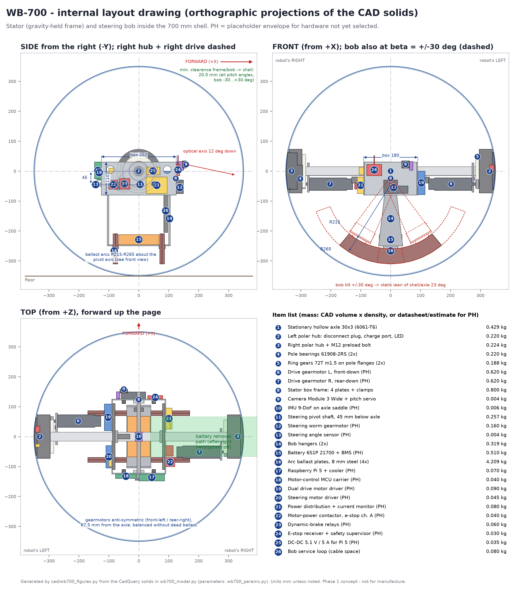{: .figpage}
*Figure 3 - Internal layout drawing: orthographic projections of the CAD solids with the item list.*

**8.1 Shell and equatorial joint.** Two thermoformed clear PC hemispheres meet on the plane y = 0. A clear
PC spigot band is bonded inside the left rim and the right hemisphere slides over it. Four key tabs
engage rim notches so the halves cannot rotate relative to each other. The joint is held closed by
**axial preload through the axle**: one M12 bolt with disc springs in the right hub. There are no
fasteners on the rolling surface. A sacrificial clear PU tape band (±100 mm) covers the seam and the
contact band.

**8.2 Polar interface.** Each pole carries a PA12-CF pole flange (aluminium bearing insert) bonded and
screwed to the shell around a Ø{{pole_open}} mm opening. The flange holds a 61908-2RS bearing and the
72T ring gear. The **stationary hubs** ride on the bearings' inner races and are keyed to the axle. Their
caps sit flush in the openings with a 2 mm running gap and recessed 1.0 mm. The **left hub carries the
manual disconnect, the charge port and the status LED.** Their cables run through the hollow axle, so no
slip ring is needed.

**8.3 Stator.** Four 3 mm 6061 plates form a 250 × 180 × 110 mm box clamped to the axle by two split
blocks. The box carries the electronics (Section 9), the steering pivot bearings, and the camera on its
servo. The IMU sits on an axle saddle 22 mm above the pitch axis to limit tangential-acceleration error.

**8.4 Twin geared drive.** Each 42 mm-class planetary gearmotor (PH envelope 42 × 145 mm) bolts to an arm
clamped on the axle. Its 18T pinion meshes with the ring gear of its own hemisphere, so the gear centre
distance is referenced to the axle and bearing, not to the compliant shell. The anti-symmetric layout
(left motor front-down, right motor rear-down) balances the stator fore-aft and sideways without dead
ballast. It also puts drive torque into **both** hemispheres, so the equatorial joint carries little
torque. When the right hemisphere is removed, its ring gear simply slides axially out of mesh.

**8.5 Steering bob.** Two 5 mm hangers hang from a Ø12 mm pivot shaft. They carry a 4 mm tray with the
battery (removable along -Y) and two groups of **laser-cut steel ballast arcs centred on the pivot
axis**. Because the arcs are concentric with the tilt axis, their clearance to the shell is set by their
outer radius alone, and ballast mass is added in 8 mm (≈1.05 kg) steps. The self-locking worm gearmotor
holds the bob angle without power, including after an e-stop.

**8.6 Clearance and interference verification.** Every shell-side internal part is a body of revolution
about the axle, so stator pitch cannot change any clearance. Each stator and bob part was therefore
checked once in the (radius, y) meridional plane against the shell, band, flanges, gears and bearings,
for bob tilts of -30, -15, 0, +15 and +30°. Results: frame and bob to shell **≥ {{clr_skin}} mm** (worst:
{{clr_skin_pair}}). Precision polar gaps are ≥ {{clr_polar}} mm (hub cap to shell opening, by design).
Exact B-rep intersections of every part pair, excluding designed contacts, were run in
{{clash_states}} states (pitch -60…+60°, tilt -30…+30°): **{{clash_n}} clashes**. Largest radius reached
by the pendulum: {{rmax}} mm (inner shell radius {{R_i}} mm).

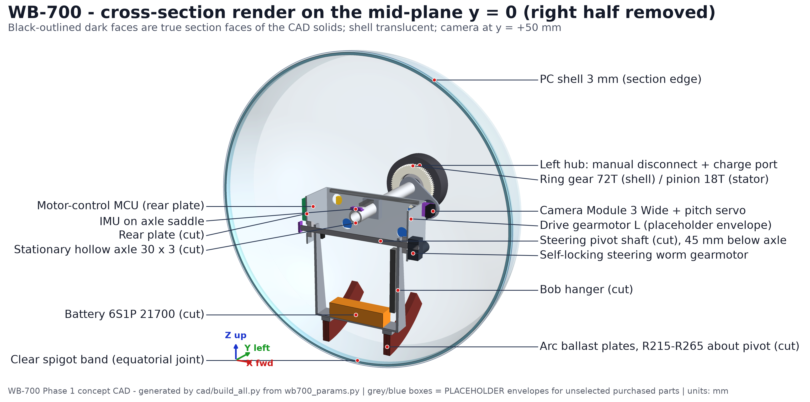{: .fig}
*Figure 4 - Cross-section render on the mid-plane (true section faces outlined).*

**8.7 Impact management.** Protection comes from several layers. The polycarbonate shell is tough and
yields rather than shatters. The PU tape band protects the rolling and optical band. The heavy pendulum
sits low and cannot derail. The steering bob has rubber end-stops. Electronics sit on standoffs on
vibration-damping mounts. The battery uses cylindrical cells in a rigid, padded tray instead of pouch
cells. The drive torque is limited in software so a gear cannot be overloaded on impact. Drop and impact
loads (0.8 ft ramp exit, barrier contact) are quantified in Phase 2.

**8.8 Service and battery access.** (1) Pull the arming plug. (2) Set the ball on its stand, left hub
down. (3) Remove the single M12 preload bolt in the right hub. (4) Lift the right hemisphere: its ring
gear slides out of mesh and its hub, bearing and flange come away with it. (5) Release the battery strap
and slide the pack out along -Y; the CAD envelope check shows this path is clear. Charging is done in
place through the left-hub port, so battery removal is a maintenance task, not a between-runs task.

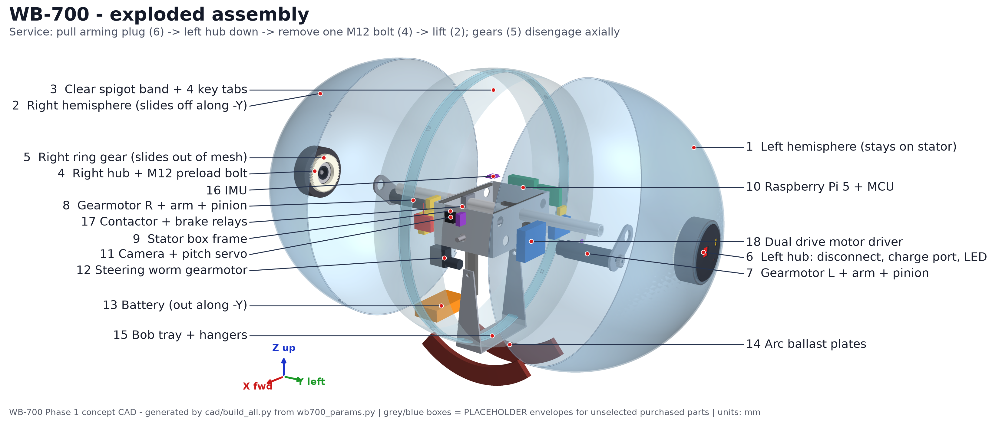{: .fig}
*Figure 5 - Exploded assembly in service order.*

## 9. Electronic component layout

{{TABLE_PLACEMENT}}

**Cable routing.** Harness trunks run along the inner faces of the side plates. The hub harness (arming
plug, charge port, LED) runs inside the Ø{{axle_id}} mm bore of the stationary axle. Battery and
steering-sensor leads reach the tilting bob through a service loop beside the front hanger, sized for
±30°. Motor leads run from the gearmotor end caps to the drivers on the side plates. Signal and motor
power runs are separated by side: drivers on the left plate, power distribution on the right.

**Thermal.** The Pi 5 uses the official active cooler and is mounted on the aluminium rear plate, which
acts as a heat spreader; the shell is sealed, so internal air temperature is monitored. A thermal
estimate is part of Phase 2 (risk R11).

## 10. Center-of-gravity strategy

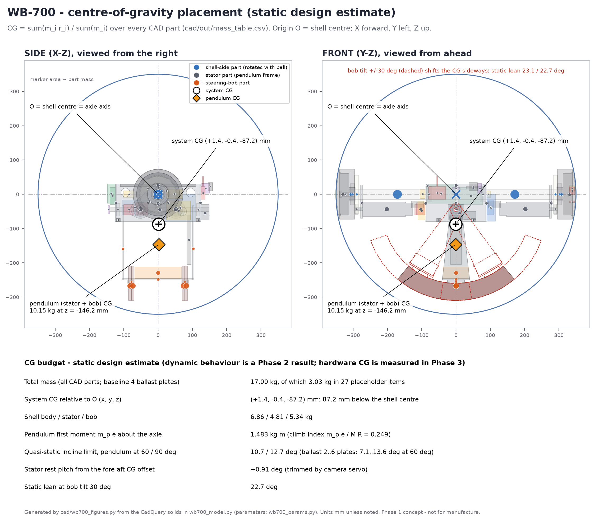{: .fig}
*Figure 6 - CG placement from the CAD mass table.*

**Method.** For every part i, mass m_i comes either from the CAD volume × material density (structural
parts) or from a datasheet value or estimate (purchased parts, flagged PH). The position r_i is the
centroid of the part's solid. Then `r_CG = Σ m_i r_i / Σ m_i`. The same calculation is repeated for the
stator and bob alone, and for every pitch and tilt state. The table is reproducible from
`cad/out/mass_table.csv`, and `Preliminary_BOM.csv` aggregates it.

{{TABLE_MASS_GROUPS}}

**Result:** **CG = ({{cg_x}}, {{cg_y}}, {{cg_z}}) mm**, i.e. {{cg_z_abs}} mm below the centre.
Pendulum first moment m_p·e = {{mpe}} kg m; climb index m_p e / (M R) = {{climb}}. The fore-aft offset
tilts the stator {{rest_pitch}}° at rest, which the camera servo trims.

**Influence on behaviour (static estimates; dynamics are validated in Phase 2):**

- *Ground-contact stability:* the contact point is always directly below the sphere centre. Any CG offset
  produces a restoring moment of M·g·{{cg_z_abs}} mm × sin(tilt), so the ball rights itself when
  disturbed.
- *Ramp climbing:* capability scales with m_p·e/(M·R). Including rolling resistance, the baseline gives a
  steady climbing limit of {{a60}}° (pendulum ≤ 60°) and the ballast range gives {{a60_min}}-{{a60_max}}°
  (Section 14). This is conditional: the ramp heights are published, their slopes are not.
- *Acceleration and braking:* the stator swings by phi ≈ asin(M_eff·a·R / (m_p·e·g)). An acceleration of
  0.5 m/s² needs about {{phi_acc}}° of swing, inside the camera-servo range. The MCU damps the swing.
- *Steering:* the bob holds {{bob_frac}} % of the pendulum mass and hangs {{L_bob}} mm below its pivot,
  so ±30° of tilt gives about ±{{lean30}}° of static lean (CAD, Figure 7). At both ±30° extremes the frame and
  bob stay at least {{clr_skin}} mm from the shell with no clashes. Turning radius and reliable gate
  navigation are Phase 2 dynamic results.
- *Disturbance recovery:* the low CG gives a strong restoring moment. Pitch oscillation (pendulum mode) is
  damped by the motor loop using IMU pitch rate.
- *Barrier contact:* the heavy, low pendulum keeps the contact force high and resists the yaw torque from
  off-centre hits. Gyro heading-hold corrects residual yaw. No internal part can derail.

These are static estimates. They do **not** guarantee stability; that is shown in Phase 2 (dynamic
model) and Phase 3 (measured CG by suspension test).

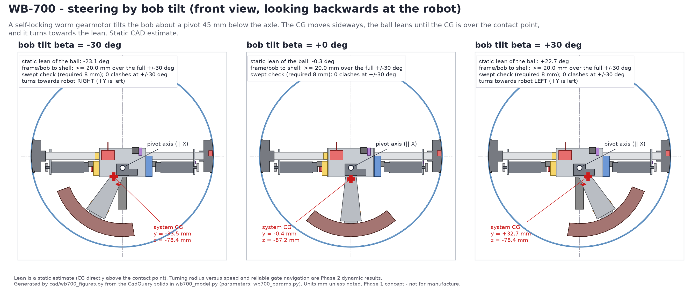{: .figwide}
*Figure 7 - Steering by bob tilt at -30°, 0° and +30°: pivot axis, sideways CG shift, static lean and clearance to the shell.*

## 11. System block diagram

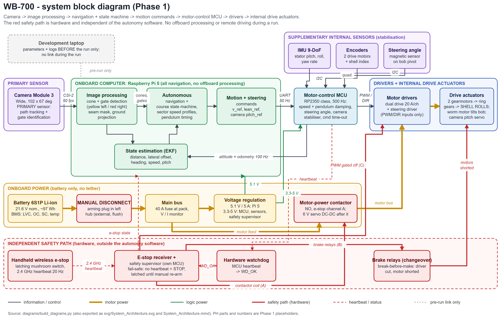{: .figwide}
*Figure 8 - System block diagram: information flow, power, and the independent safety path (red).*

**How the system operates.** (1) **Power-up:** the arming plug is inserted and the logic rail boots the
Pi 5, MCU and safety supervisor. The MCU self-tests its sensors, encoders and drivers with motor power
still off. (2) **Arm:** the operator sets the e-stop transmitter to RUN. The supervisor closes the
contactor and energises the brake relays (motors connected to the drivers) only if the heartbeat is
valid and WD_OK is high. (3) **Calibrate:** in Sector 1 the vision node locks colour thresholds and
exposure on the chevron gates while rolling slowly. (4) **Run:** the Pi 5 turns images into a lane model.
The EKF fuses it with IMU and encoder data, and the state machine selects the sector behaviour and sends
v_ref and lean_ref at 50 Hz over UART. The MCU closes drive-speed, pendulum-damping, bob-angle and camera
loops at 500 Hz. If commands stop for more than 200 ms the MCU makes a controlled stop. (5) **Stop:** at
the finish, on any software fault (SAFE_STOP), or on the hardware e-stop, which acts on all three
channels and latches.

The development laptop is used only before the run, to set parameters and download logs. It is
disconnected during the run, so there is no remote driving and no offboard processing.

## 12. Preliminary power and control architecture

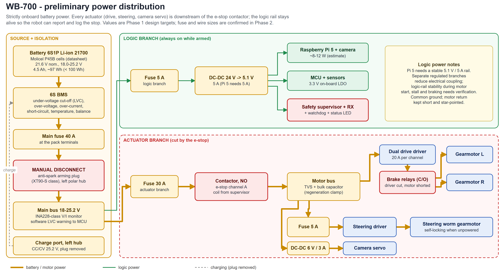{: .figwide}
*Figure 9 - Preliminary power distribution: every actuator is downstream of the e-stop contactor.*

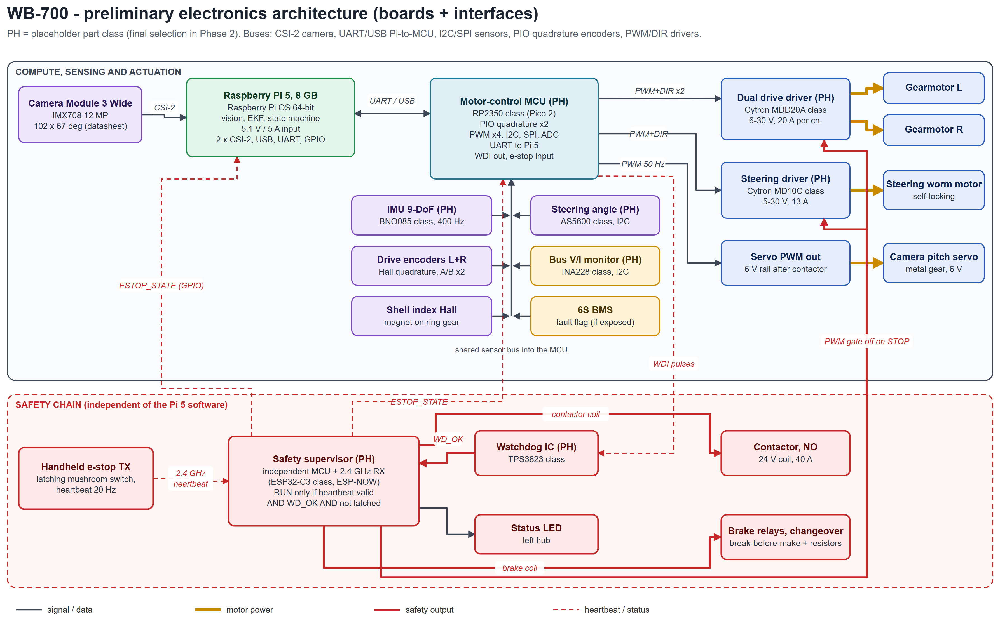{: .figwide}
*Figure 10 - Preliminary electronics architecture (boards and interfaces).*

**Component-interface table**

{{TABLE_INTERFACES}}

**Control loops (targets):** drive speed and pendulum-pitch damping 500 Hz (MCU); steering-bob angle
500 Hz (MCU); camera pitch stabiliser 100 Hz (MCU); EKF 100 Hz (Pi 5); vision 30-50 Hz (Pi 5); state
machine and planners 50 Hz (Pi 5).

**Energy (estimate, validated in Phase 2):** a ≈97 Wh pack against roughly 10-15 W of electronics
(Pi 5 + camera, estimate) plus about 40-80 W average drive power while moving (estimate). A 2-minute run
uses only a few Wh, so three attempts and practice runs fit comfortably on one charge.

## 13. Vision-based navigation concept

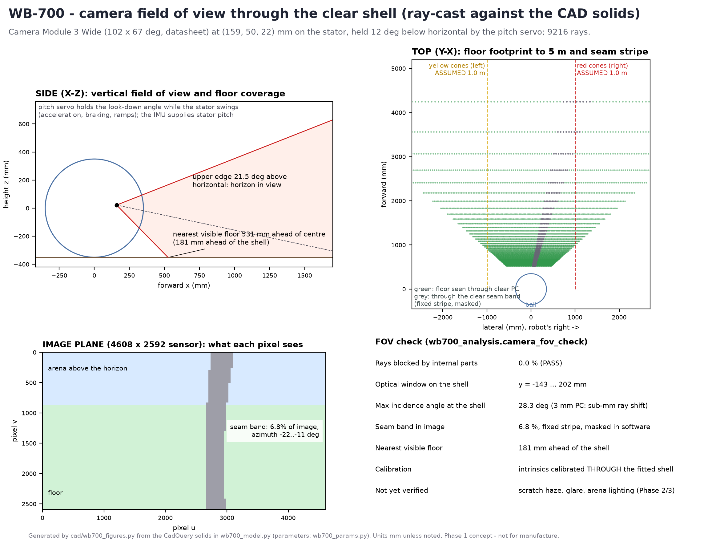{: .fig}
*Figure 11 - Camera field of view ray-cast against the CAD solids.*

- **Sensor:** Raspberry Pi Camera Module 3 Wide (IMX708, 102° × 67°, 2.75 mm, f/2.2, from the datasheet)
  at 1280 × 720 and 50 fps. Its wide vertical view keeps the near track visible
  ({{floor_near}} mm ahead of the shell) and the horizon in view.
- **Through-shell imaging:** the camera sits 159 mm ahead of the centre, so rays meet the 3 mm shell at
  ≤ {{max_inc}}° incidence and are displaced by less than a millimetre. Intrinsics are calibrated with
  the shell installed. The clear seam band covers {{seam_pct}} % of the image as a fixed stripe at
  {{seam_az0}}° to {{seam_az1}}°, which is masked. Interior surfaces near the camera are matte black to
  limit reflections.
- **Pipeline (Figure 12):** rectify → IMU/servo ground homography → adaptive HSV segmentation of red and
  yellow cones → blob filtering and ground projection → RANSAC boundary model (yellow = left,
  red = right) → lane centre, heading error and gate detection → EKF. An optional YOLO-nano-class
  detector (CPU, or an AI accelerator HAT if added) cross-checks cones and detects the pendulum.
- **Robustness:** auto-calibration on the Sector 1 chevron gates; a lane-loss timer (> 0.5 s triggers
  SAFE_STOP); gyro and odometry dead-reckoning bridge short occlusions in the wrecking zone.

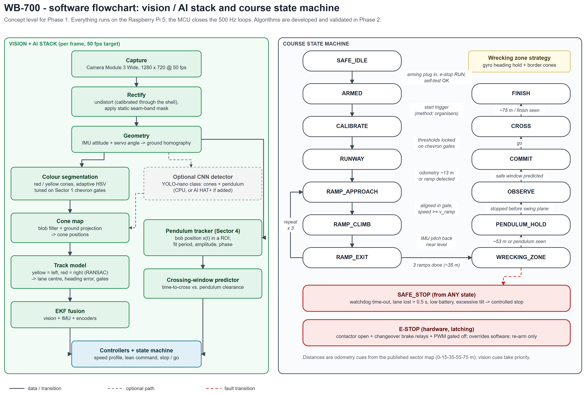{: .figwide}
*Figure 12 - Vision / AI stack and course state machine (concept).*

## 14. Approach to ramps and low-density obstacles

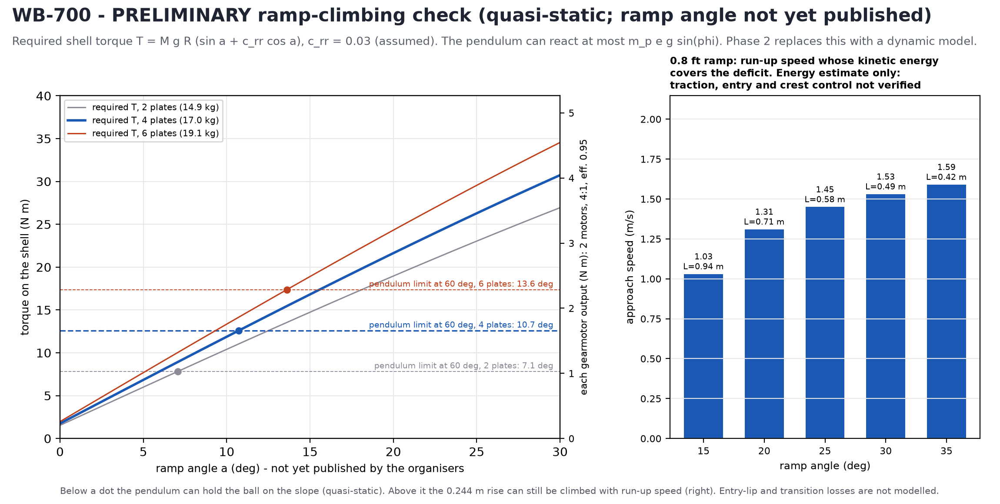{: .fig}
*Figure 13 - Preliminary ramp check (quasi-static) and run-up speeds for the 0.8 ft rise.*

{{TABLE_TORQUE}}

**Ramps.** In RAMP_APPROACH the robot centres in the funnel gate, aligns its heading with the gyro and
reaches v_ramp. In RAMP_CLIMB it switches to torque mode with the pendulum angle capped at 60°, so it
cannot loop over. Ramps steeper than the {{a60}}° steady limit need run-up energy (table below). The
table is an energy estimate only: it does not show that traction holds, that the entry transition is
survivable or that the robot stays controllable at the crest.

**Motor operating points (per motor, gearmotor output, 4:1 at 95 %):** steady climb at {{a60}}°:
{{T_climb}} N m at {{rpm_climb}} rpm (0.5 m/s, assumed); cruise at {{v_target}} m/s: {{T_cruise}} N m at
{{rpm_motor}} rpm; pendulum horizontal: {{Tm_react}} N m, short-term. Target motor at 24 V: rated
(continuous) ≥ 2 N m, stall ≥ 4 N m, no-load ≥ {{n0_spec}} rpm. At the 18.0 V minimum pack voltage this
leaves about {{stall_vmin}} N m stall, {{n0_vmin}} rpm unloaded and about {{climb_rpm_vmin}} rpm at the
climb torque.

**Drive-motor selection evidence (selection pending).** No motor model is chosen yet; the table states
what the chosen part must show on its datasheet at the same operating point.

| Item | Requirement | Selected motor |
|---|---|---|
| Model | 42 mm-class 24 V brushed planetary gearmotor with Hall encoder | **pending (Phase 2)** |
| Supply for the check | 18.0 V minimum pack voltage (6S at cut-off) | pending |
| Climb point | {{T_climb}} N m continuous at ≥ {{rpm_climb}} rpm at 18 V | pending |
| Cruise point | {{T_cruise}} N m at ≥ {{rpm_motor}} rpm at 18 V | pending |
| Peak | {{Tm_react}} N m short-term (pendulum horizontal) | pending |
| Current | continuous current at the climb point ≤ driver 20 A/ch continuous; stall ≤ 60 A peak | pending |
| Thermal | climb point sustainable for ≥ 30 s (longest ramp approach) within rated winding temperature | pending |

In RAMP_EXIT it brakes with pendulum damping, because what lies beyond the top (down-slope or
drop) is unknown (Q3). The design levers are ballast (2-6 plates), shell diameter (a parameter) and the
gear ratio.

{{TABLE_MOMENTUM}}

**Low-density obstacles (Sector 3).** Foam, thermocol and cardboard are pushed or rolled over rather
than avoided. The robot keeps 1-1.5 m/s for momentum and holds heading on the gyro while border cones
remain visible. Nothing inside can derail on impact, and the PC shell and tape band take the abrasion. A
quasi-static lip of about {{lip}} mm can be mounted from standstill; larger debris is crossed
dynamically (run-up), which Phase 2 quantifies.

## 15. Pendulum-detection and safe-crossing concept

1. **Detect:** at about 53 m (odometry), or when the vision node flags a periodic mover crossing the lane,
   enter PENDULUM_HOLD and stop at a hold line before the swing plane. A pendulum robot must be
   *actively* held, so the MCU uses encoder and IMU station-keeping.
2. **Observe:** track the bob's image position x(t) in a region of interest over 2-3 swings. Fit
   x(t) = A·sin(2πt/T + φ0) to obtain period, amplitude and phase with a confidence estimate.
3. **Predict:** compute the required clear interval t_req = t_delay + t_cross + t_margin, where t_cross
   is the time for the whole 0.70 m sphere to leave the hold line and clear the swing corridor. With the
   CAD-based launch acceleration of about {{a_launch}} m/s² (pendulum at 60°), a 0.3 m hold distance, a
   0.5 m corridor (assumed, Q6) and a 1.5 m/s cap, t_cross ≈ {{t_cross}} s; with 0.15 s sensing delay and a
   0.5 s margin, t_req ≈ {{t_req}} s. Find the next window in which the bob stays outside the corridor for
   t_req.
4. **Commit and cross:** start at the computed instant and do not stop or reverse inside the swing zone,
   because continuing clears it sooner than backing out. If confidence drops before the commit point,
   stay at the hold line and re-track. Holding is feasible because a level floor needs almost no drive
   torque to keep station. The crossing policy never overrides emergency stop or a detected safety fault;
   safety shutdown remains active in every operating state.

Pendulum geometry, period and position are not yet published (Q6). Algorithms are simulated in Phase 2
and validated with a test pendulum in Phase 3.

## 16. Emergency-stop and fail-safe concept

- **Transmitter:** handheld, battery-powered, latching mushroom switch, 2.4 GHz heartbeat at 20 Hz. It
  carries no motion commands.
- **Supervisor:** an independent MCU and receiver, powered from the logic rail. RUN = (valid heartbeat
  within 250 ms) AND (WD_OK) AND (not latched). Otherwise:
  **A** opens the normally-open motor-power contactor (all drivers and actuators lose power);
  **B** gates both drivers' PWM inputs to zero through a supervisor-controlled gate with pull-downs (the
  MDD20A and MD10C have PWM/DIR inputs only, no enable pin);
  **C** releases changeover brake relays: the normally-open side connects each drive motor to its driver,
  the normally-closed side shorts it through a resistor, and break-before-make means a driven output is
  never shorted. All three are fail-safe: loss of power or signal produces STOP.
- **Actuation versus motion:** STOP ends all motor actuation immediately. The sphere itself coasts,
  slowed by rolling resistance and the shorted motors, and can roll on a slope; Phase 2 quantifies the
  stopping distance.
- **Supervisor freeze:** the contactor and brake-relay coils are driven through pulse-driven
  (charge-pump) stages that stay energised only while the supervisor keeps toggling its outputs. A frozen
  supervisor, stuck high or low, lets every coil drop out, which is STOP. Every safety output defaults to
  the de-energised (stopped) state at power-up and on any wiring break.
- **Status of this section:** a concept-level design. The detailed relay and gate schematic, and the
  measured stop latency, are Phase 2 deliverables.
- **Watchdog:** the motor MCU must toggle WDI. If it hangs, WD_OK drops and the supervisor stops the
  robot.
- **Latching and re-arm:** a stop persists until the transmitter is reset *and* re-arm is requested. The
  status LED in the left hub shows armed, e-stop or fault.
- **Manual disconnect:** the anti-spark arming plug in the left hub isolates the battery for handling,
  charging and inspection.
- **Latency budget (target, measured in Phase 2):** heartbeat timeout 250 ms; button-to-contactor under
  100 ms when a STOP packet is received; contactor release about 10-20 ms (relay class).

| Failure | Effect | Response |
|---|---|---|
| Transmitter battery dead or out of range | no heartbeat | STOP within 250 ms (fail-safe) |
| Pi 5 crash | no commands | MCU stops (200 ms time-out); e-stop still active |
| MCU crash | WDI stops | watchdog then supervisor: STOP |
| Supervisor brown-out | coil drive lost | contactor opens, brakes drop: STOP |
| Contactor welded | channel A lost | channels B + C still stop the motors; self-test at arming |

## 17. Preliminary bill of materials and mass budget

{{TABLE_BOM}}

The full list with CG coordinates, mass basis and placeholder flags is in **Preliminary_BOM.csv**.
**No prices are given**: none have been quoted or verified yet. Placeholder items total {{ph_mass}} kg;
their final masses are confirmed when parts are selected (Phase 2) and weighed (Phase 3).

## 18. Manufacturing and assembly approach

| Part family | Process | Notes |
|---|---|---|
| PC hemispheres Ø700 | purchased thermoformed domes | sourcing, wall uniformity and tolerance to be confirmed (risk R9) |
| Spigot band, key tabs | rolled and solvent-bonded PC strip | bonded into the left rim on a fixture |
| Stator plates, arms, hangers, tray | laser-cut 6061 / 5052 sheet, tapped | flat parts, DXF from CAD |
| Ballast arcs | laser-cut 8 mm mild steel | flat profiles; count tunes the CG |
| Axle, pivot shaft | cut tube / ground rod | flats for the keyed hubs |
| Pole flanges, hub caps | PA12-CF 3D print + aluminium inserts | bearing seats reamed after printing |
| Ring gears / pinions | stock m1.5 POM and steel gears, bored | concentricity to the bearing checked on the lathe |

**Assembly sequence:** (1) Build the stator (plates, clamps, axle, pivot, bob, electronics) and test the
electronics on the bench. (2) Fit the left flange and bearing to the left hemisphere; slide in the
stator and fit the left hub. (3) Mesh the left gears. (4) Fit the right hemisphere; its ring gear meshes
on assembly. (5) Torque the M12 preload bolt. (6) Apply the tape band. **Quality checks:** diameter with a
go/no-go ring gauge (2.5 ft) and a 2.0 ft gauge; CG by a two-axis suspension test; static balance; e-stop
functional test at every arming.

## 19. Main technical risks and mitigation strategies

{{TABLE_RISKS}}

## 20. Design assumptions and unresolved organizer questions

**Assumptions:** (A1) The track is essentially linear; turn radii are unknown. (A2) Track width of about
2 m is used only to illustrate the field of view. (A3) Ramp angles are unknown, so capability is shown
from 5 to 35°. (A4) Rolling resistance c_rr = 0.03. (A5) Uniform 3 mm shell (real domes thin toward the
pole). (A6) Purchased-part masses are estimates (PH, {{ph_mass}} kg). (A7) Gear stage efficiency 0.95.
(A8) Indoor, hard and level floor with adequate lighting. (A9) A team-built wireless e-stop is
acceptable. (A10) **No weight limit is stated, and none is assumed**; inspection records the weight.

**Questions for the organizers** (to be posted in the official Doubts section; full list in
*Open_Questions_for_Organizers.md*): ramp angle, length, surface and entry/exit geometry; track and gate
widths and cone size; pendulum size, period, amplitude and position; how the diameter is measured and
whether limits are exclusive; the meaning of "electrical isolation" at inspection; kill-switch
requirements; start procedure; whether AI-assisted documentation is acceptable and must be disclosed;
and the Round 1 submission format and channel.

## 21. Future validation plan for Phase 2 (target 15 Nov 2026)

| Phase 2 deliverable | Method | Acceptance target |
|---|---|---|
| Actuator torque + gear ratio for the 0.8 ft ramp | 3-body dynamic model (shell, stator, bob) for ramps 5-35°, steps and stops; motor torque-speed curves | gearmotor selected with ≥ 1.5× margin at the worst case |
| Ramp feasibility and stability | simulation including run-up, entry lip and exit (down-slope or drop) | climbs all three ramps in simulation with the confirmed geometry |
| Balance stability | linearised pitch/roll model; LQR/PID damping design | pitch oscillation settles within 2 s |
| Gear, axle and bearing loads | hand calculation + FE for impact cases (0.8 ft drop, barrier hit) | SF ≥ 2 on yield, bearing life adequate |
| Battery and runtime | measured Pi 5 power + simulated motor currents | ≥ 3 full runs plus 20 min reserve |
| Kill switch | bench prototype; latency and fail-safe tests (TX off, interference, MCU hang) | stop < 300 ms in every case |
| Vision | cone and pendulum datasets; through-PC imaging test on a PC sample | lane estimate error < 0.15 m at 5 m |
| Pendulum crossing | Monte-Carlo timing simulation with assumed pendulum parameters | zero simulated collisions at the chosen margin |
| Full track | integrated simulation of the 75 m course | finishes without cone contact in simulation |

## Appendix A - Reproducing the CAD, checks and figures

```
cd cad
..\.venv\Scripts\python.exe build_all.py          # checks, STEP/STL/GLB, renders, drawings
cd ..\diagrams
..\.venv\Scripts\python.exe build_diagrams.py     # system / electronics / power / software diagrams
cd ..\docs_src
..\.venv\Scripts\python.exe build_docs.py         # regenerates both documents, CSVs and PDFs
```

Python 3.12 venv packages: cadquery 2.8, pyvista 0.49 / VTK 9.6, trimesh 5.1, manifold3d, shapely 2.2,
matplotlib 3.11, markdown, python-docx, pymupdf. Diagrams and PDFs are rendered with headless Microsoft
Edge.

## Appendix B - Verification results (from cad/out/analysis_results.json)

{{TABLE_CHECKS}}

## Appendix C - References

1. Techfest IIT Bombay, *The Wrecking Ball Challenge* problem statement (5 pp., 2026-27), and official page
   <https://techfest.org/competitions/wrecking-ball-challenge> with the Round 1 submission template
   (accessed 2026-10-20).
2. R. Chase, A. Pandya, "A Review of Active Mechanical Driving Principles of Spherical Robots,"
   *Robotics* 1(1):3-23, 2012. doi:10.3390/robotics1010003.
3. A. Halme, T. Schönberg, Y. Wang, "Motion control of a spherical mobile robot," Proc. 4th IEEE Int.
   Workshop on Advanced Motion Control (AMC'96), vol. 1, pp. 259-264, 1996. doi:10.1109/AMC.1996.509415.
4. T. J. Ylikorpi, A. J. Halme, P. J. Forsman, "Dynamic modeling and obstacle-crossing capability of
   flexible pendulum-driven ball-shaped robots," *Robotics and Autonomous Systems* 87:269-280, 2017.
5. H. Kolbari, A. Ahmadi, M. Bahrami, F. Janati, "Impedance estimation and motion control of a
   pendulum-driven spherical robot," 6th RSI Int. Conf. on Robotics and Mechatronics (IcRoM), pp. 6-11, 2018.
6. SphBot repository, <https://github.com/alirezaahmadi/SphBot> (MIT licence, © 2019 Alireza Ahmadi).
7. Rollie repository, <https://github.com/dformoso/rollie> (MIT licence, © 2025 Daniel Martinez Formoso).
8. Integral-Robotics-Lab, Spherical-Robot repository,
   <https://github.com/Integral-Robotics-Lab/Spherical-Robot> (no licence file found).
9. New Atlas, "Rotundus GroundBot ..." (24 Oct 2011), <https://newatlas.com/rotundus-groundbot/20259/>.
10. Raspberry Pi Ltd, *Raspberry Pi Camera Module 3 product brief* (June 2024): dimensions, FoV, focal length.
11. Raspberry Pi Ltd, *Raspberry Pi 5 product brief*: 85 × 56 mm board, 5 V / 5 A USB-C, two 4-lane MIPI interfaces.
12. Molicel, *INR-21700-P45B datasheet*: 4.5 Ah, 45 A continuous, 21.4 × 70.0 mm, ≤ 70 g.
13. 3M, *Polyurethane Protective Tape 8671/8671HS technical data sheet*: transparent TPU, 0.014 in (0.35 mm).
14. Cytron, MDD20A and MD10C motor drivers: ratings as listed by authorised retailers (to be checked
    against the Cytron datasheets in Phase 2).
15. IATA / CASA lithium-battery passenger guidance: ≤ 100 Wh without airline approval; 100-160 Wh with
    approval.
